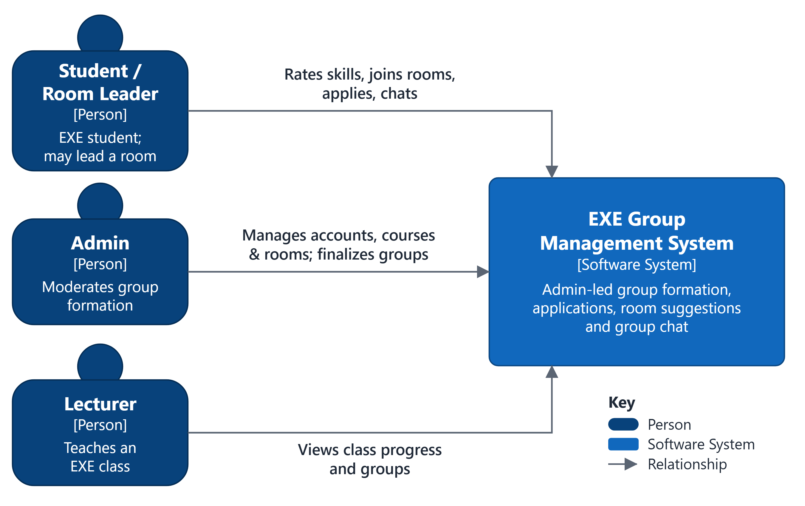
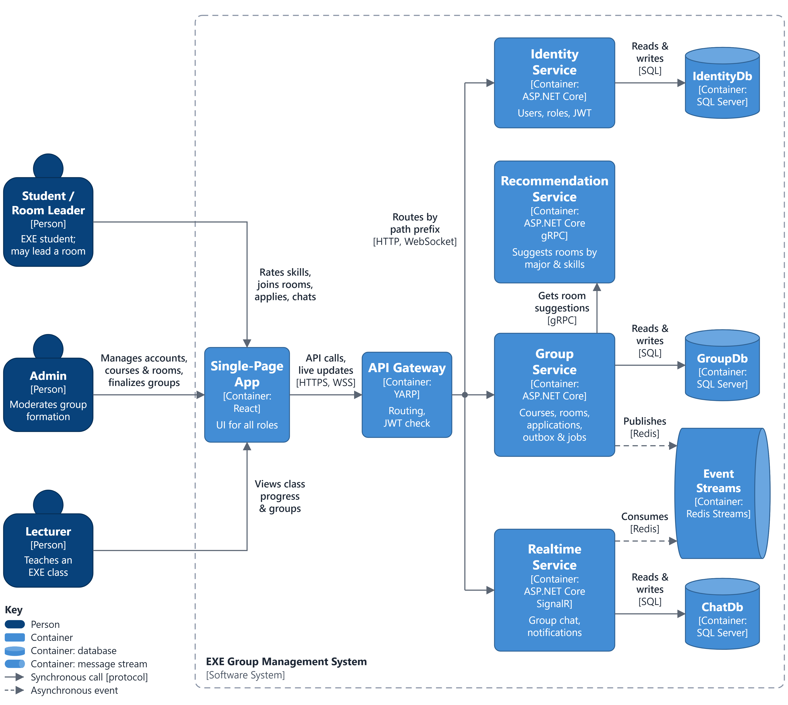

# EXE Group Management System

PRN232 – Building Cross-Platform Back-End Application with .NET · Final Assignment

## 1. Project description

Students in EXE (Experiential Entrepreneurship) courses must form project groups inside their class. Today this
happens across chat groups and spreadsheets, so open slots, pending join requests and students without a group are
hard to track.

The EXE Group Management System centralizes group formation:

- Students search groups, create a group or send join requests in the classes they are enrolled in.
- Team Leaders approve or reject the requests for their own group, remove members and transfer leadership.
- Lecturers monitor grouping progress, under-filled groups and ungrouped students.
- Administrators manage users, semesters, courses, classes (MinMembers, MaxMembers, Deadline) and class rosters.

The backend enforces the class rules: enrollment required, one group per student per class, capacity and deadline.

The full design is in [`docs/PRN232_v2.pdf`](docs/PRN232_v2.pdf) / [`docs/PRN232_v2.docx`](docs/PRN232_v2.docx);
the assignment brief and the two labs the team builds on are in [`docs/`](docs/).

## 2. System architecture

Microservices documented with the C4 model. Level 1 and Level 2 below; Level 3 (components), deployment and the
approve-flow dynamic view are generated from [`docs/architecture/workspace.dsl`](docs/architecture/workspace.dsl).

| Level 1 – System Context | Level 2 – Container |
|---|---|
|  |  |

Generated views (Structurizr DSL → C4-PlantUML; components marked [Planned] are designed but not implemented yet):

| View | Diagram |
|---|---|
| Level 3 – Identity Service | [IdentityComponents](docs/architecture/diagrams/structurizr-IdentityComponents.png) |
| Level 3 – Group Service | [GroupComponents](docs/architecture/diagrams/structurizr-GroupComponents.png) |
| Level 3 – Join Request Service | [JoinRequestComponents](docs/architecture/diagrams/structurizr-JoinRequestComponents.png) |
| Dynamic – approving a join request | [ApproveJoinRequest](docs/architecture/diagrams/structurizr-ApproveJoinRequest.png) |
| Deployment – Docker Compose | [Deployment](docs/architecture/diagrams/structurizr-Deployment.png) |
| Deployment – demo server | [DemoDeployment](docs/architecture/diagrams/structurizr-DemoDeployment.png) |

Regenerate after a change: `docker run --rm -v "$PWD/docs/architecture:/usr/local/structurizr" structurizr/structurizr export -workspace /usr/local/structurizr/workspace.dsl -format plantuml/c4plantuml -output /usr/local/structurizr/diagrams`, then render with `plantuml/plantuml -tpng`.

| Container | Technology | Responsibility |
|---|---|---|
| Single-Page App | React 19, TypeScript, Vite, served by nginx | UI for all roles; nginx forwards `/api` and `/swagger` to the gateway (same origin, no CORS) |
| API Gateway | ASP.NET Core 10 + YARP 2.3 | Single entry point, JWT check at the edge, path routing, merged Swagger UI, sign-in rate limit |
| Identity Service | ASP.NET Core 10 Web API | Sign-in, JWT access and refresh tokens, users, roles |
| Group Service | ASP.NET Core 10 Web API + gRPC server | Semesters, courses, classes, rosters, groups; outbox, deadline and cleanup jobs |
| Join Request Service | ASP.NET Core 10 Web API + gRPC client | Join-request lifecycle; event consumer, reconciler and cleanup jobs |
| IdentityDb / GroupDb / RequestDb | SQL Server 2022 (EF Core 10) | One database per service |
| Group Events | Redis 7 Stream `group-events` | `GroupMemberAdded`, `GroupClosed` from Group Service to Join Request Service |

How the services talk to each other:

- **REST:** browser → web (nginx) → gateway → services. Every route is versioned (`/api/v1/...`) and every response,
  including errors, uses one envelope:
  `{ "success", "message", "data", "errors": [{ "code", "field", "message" }], "traceId", "pagination" }`.
- **gRPC:** Join Request Service → Group Service on an internal HTTP/2-only port (8081).
  `GroupMembership.GetGroupContext` checks eligibility and leadership; `AddMemberIfEligible` adds the member in one
  transaction and is idempotent by `request_id`. Contract:
  [`src/Contracts/ExeGroup.Contracts/group_membership.proto`](src/Contracts/ExeGroup.Contracts/group_membership.proto).
- **Redis Streams:** Group Service publishes through a Transactional Outbox (`OutboxEvents`). Join Request Service
  reads with `XREADGROUP` (consumer group `join-request-service`), acknowledges with `XACK` after commit, re-claims
  stuck messages with `XAUTOCLAIM`, and skips duplicates through the `ProcessedEvents` table.
- **Approve flow:** `POST /api/v1/join-requests/{id}/approve` returns `202 Accepted` (status Processing); the request
  becomes Approved when the `GroupMemberAdded` event is consumed, and the web app polls `GET /api/v1/join-requests/{id}`.
  If that event is lost, ProcessingReconciler retries `AddMemberIfEligible` after 2 minutes; the `ALREADY_ADDED` reply
  confirms the request as Approved directly (transition T11).
- **Tracing:** the gateway assigns an `X-Correlation-ID`; it travels through HTTP headers, gRPC metadata and the event
  envelope, appears in every log line and comes back as `traceId` in every response.

## 3. Technology stack

| Area | Technology |
|---|---|
| Runtime | .NET 10 (SDK pinned in `global.json`), C# latest, nullable enabled, warnings as errors |
| Backend | ASP.NET Core 10, three projects per service: API → Services → Repositories (enforced by architecture tests) |
| Data | Entity Framework Core 10, SQL Server 2022, code-first migrations (`scripts/ef`) |
| Gateway | YARP 2.3 |
| Sync communication | gRPC (Grpc.AspNetCore / Grpc.Net.ClientFactory 2.85, Protobuf over HTTP/2) |
| Messaging | Redis 7 Streams (StackExchange.Redis 3.x) |
| Background jobs | `BackgroundService` + `PeriodicTimer` through a shared `PeriodicBackgroundService` base |
| Security | JWT Bearer HS256 (key ≥ 32 bytes, validated at start-up), refresh tokens, ASP.NET Core `PasswordHasher` |
| API surface | URL versioning (Asp.Versioning 10), JSON and XML (406 for anything else), DataAnnotations + FluentValidation |
| API docs | Swashbuckle 10 (OpenAPI), one document per service, merged Swagger UI with Authorize button at the gateway |
| Logging | Serilog with correlation id; custom request-logging and exception middleware |
| Frontend | React 19, TypeScript 7, Vite 8, React Router 7, TanStack Query 5, Vitest, oxlint, nginx |
| Tests | xUnit v3 on Microsoft.Testing.Platform, Testcontainers (real SQL Server), NetArchTest |
| Deployment | Docker, Docker Compose (7 containers), GitHub Actions CI |

## 4. Installation guide

### Prerequisites

- Docker Desktop (with Docker Compose v2)
- .NET 10 SDK and Node.js 22 – only for running or testing outside Docker
- Git

### Repository layout

```text
src/
  BuildingBlocks/        shared envelope, errors, paging, JWT, Swagger, health, jobs (ExeGroup.BuildingBlocks[.Web])
  Contracts/             group_membership.proto (gRPC client + server code)
  ApiGateway/            YARP gateway
  IdentityService/       ExeGroup.Identity.API / .Services / .Repositories   (IdentityDb)
  GroupService/          ExeGroup.Group.API / .Services / .Repositories      (GroupDb, gRPC :8081)
  JoinRequestService/    ExeGroup.JoinRequest.API / .Services / .Repositories (RequestDb)
  web/                   React single-page app + nginx.conf
tests/                   architecture, building-block, gateway and integration tests
docker/                  shared Dockerfile for the .NET services
database/schema.sql      reference DDL (EF Core migrations are the runtime source of truth)
docs/                    brief, labs, design document, diagrams, C4 workspace
scripts/                 ef.sh / ef.ps1 (migrations), dev-token.mjs (test tokens)
```

### Steps

1. Clone the repository and open the root folder.
2. Copy `.env.example` to `.env` and set the secrets (never commit `.env`):

   ```env
   SA_PASSWORD=<strong SQL Server password>
   JWT_SIGNING_KEY=<output of: openssl rand -base64 48>
   JWT_ISSUER=exe-group-system
   JWT_AUDIENCE=exe-group-clients
   SEED_ADMIN_EMAIL=<e-mail of the first Administrator>
   SEED_ADMIN_PASSWORD=<initial password>
   SQL_HOST_PORT=14330
   REDIS_HOST_PORT=16379
   GATEWAY_HOST_PORT=8080
   WEB_HOST_PORT=3000
   ```

   Change a `*_HOST_PORT` if that port is already used on your machine (for example a local SQL Server on 1433).
3. Build and start everything:

   ```bash
   docker compose up -d --build
   ```

4. Wait until the containers are healthy (`docker compose ps`). Each service applies its EF Core migrations at
   start-up in Development; `/health/ready` stays `503` until that has finished, and the gateway starts only after all
   three services are ready.
5. Open the apps:
   - Web app: <http://localhost:3000>
   - Swagger UI (all three services): <http://localhost:8080/swagger>
6. For a test token while sign-in is being built: `node scripts/dev-token.mjs Administrator` and paste it into the
   Swagger **Authorize** dialog.

Run the tests (Docker must be running for the SQL Server containers):

```bash
dotnet tool restore
dotnet test --solution ExeGroup.sln
cd src/web && npm ci && npm run lint && npm run typecheck && npm test && npm run build
```

## 5. Deployment instructions

| Service | Image / build | Ports | Depends on (healthy) |
|---|---|---|---|
| web | `src/web/Dockerfile` (node:22 build → nginx:1.27-alpine) | `${WEB_HOST_PORT:-3000}` → 80 | gateway |
| gateway | `docker/dotnet-service.Dockerfile` (`ExeGroup.ApiGateway`) | `${GATEWAY_HOST_PORT:-8080}` → 8080 | identity, group, join-request |
| identity-service | `docker/dotnet-service.Dockerfile` | internal 8080 | sqlserver |
| group-service | `docker/dotnet-service.Dockerfile` | internal 8080 (REST), 8081 (gRPC, HTTP/2 only) | sqlserver, redis |
| join-request-service | `docker/dotnet-service.Dockerfile` | internal 8080 | sqlserver, redis, group-service |
| sqlserver | `mcr.microsoft.com/mssql/server:2022-latest` | internal 1433 (host `${SQL_HOST_PORT:-14330}` in development) | – |
| redis | `redis:7-alpine` (`appendonly yes`) | internal 6379 (host `${REDIS_HOST_PORT:-16379}` in development) | – |

Notes:

- `docker-compose.override.yml` is loaded automatically in development and is the only file that publishes the SQL
  Server and Redis ports. For a submission or demo build without it: `docker compose -f docker-compose.yml up -d --build`.
- The gateway checks the JWT for every route except `/api/v1/auth/login`, `/api/v1/auth/refresh-token`, `/api/v1/auth/logout`, `/swagger/**`
  and `/health/**`; each service checks it again and applies the business permissions.
- Configuration comes from `appsettings.json`, overridden by environment variables such as
  `ConnectionStrings__GroupDb`, `Jwt__SigningKey`, `Redis__Connection`, `GrpcClients__GroupService`.
- Health checks: `/health/live` and `/health/ready` on every service (ready = own database, Redis where used, and
  migrations applied).
- Logs: `docker compose logs -f group-service join-request-service`; follow one request with its correlation id:
  `docker compose logs | grep <traceId>`.
- gRPC from inside the network: `docker run --rm --network exe-group_default fullstorydev/grpcurl -plaintext group-service:8081 list`.
- Stream inspection: `docker compose exec redis redis-cli XRANGE group-events - +` and
  `docker compose exec redis redis-cli XINFO GROUPS group-events`.

### Demo on the shared server

Merging into `main` redeploys the demo at `https://exe.qizhub.com`. After `ci` turns green on `main`, the `deploy-demo`
workflow asks the server to deploy that commit. The server builds it, runs the smoke checks and returns to the last good
version if anything fails. Follow it in the **Actions** tab; a failed deployment never blocks pull requests.

- `docker-compose.demo.yml` is an overlay on `docker-compose.yml`: project `exe-group-demo`, Production, migrations on
  start-up, no host ports, memory and CPU limits. `node scripts/check-demo-compose.mjs` verifies this in CI.
- Traffic goes through Cloudflare and the server's reverse proxy to the `web` container, the only container on the shared
  network.
- The deploy key can only run `scripts/demo-deploy-entry.sh` for a commit that is on `main`. It lives in the `demo`
  GitHub environment, which only `main` can use, so pull requests cannot read it.
- Secrets stay in `demo.env` on the server (`SA_PASSWORD`, `JWT_SIGNING_KEY`, `JWT_ISSUER`, `JWT_AUDIENCE`,
  `ASPNETCORE_ENVIRONMENT=Production`), never in the repository. Do not store real student data on this demo.
- The server hosts other projects: never run `docker system prune` or `docker compose down -v` there.

### Merging into main

`main` accepts pull requests only. The checks `dotnet`, `web`, `docker` and `architecture` must be green on a branch that is
up to date with `main`; nobody can skip them. Use **Update branch** when asked, and **Enable auto-merge** to let GitHub
squash-merge once everything passes.

## 6. Demo script (end-to-end)

| Step | Action | What it demonstrates |
|---|---|---|
| 1 | `docker compose ps` – all containers healthy; show the C4 diagrams | Docker deployment, system architecture |
| 2 | Administrator signs in (Swagger), creates a semester, a course and a class (MinMembers, MaxMembers, Deadline), then enrolls students | REST API, JWT, CRUD, versioning, validation |
| 3 | Student A creates a group and becomes Team Leader (`GroupMemberAdded` with an empty requestId) | REST, outbox |
| 4 | Student B searches groups (`search`, `sort`, `page`, `fields`) and submits a join request – Pending | REST, gRPC `GetGroupContext` |
| 5 | Team Leader approves – 202 Processing; OutboxPublisher publishes, GroupEventsConsumer marks the request Approved and cancels B's other Pending requests | gRPC `AddMemberIfEligible`, background jobs, message publishing and consuming |
| 6 | Show `XRANGE group-events - +` and the logs of both services with the same correlation id | Message broker, tracing |
| 7 | Lecturer opens the class overview: grouped / ungrouped students, under-filled groups | REST, authorization |
| 8 | Set the class Deadline one or two minutes ahead and wait: DeadlineEnforcer locks the groups and the remaining Pending requests are rejected (GROUP_LOCKED) | Background job, events |

## 7. Team members & responsibilities

| No. | Full name | Student ID | Responsibilities |
|---|---|---|---|
| 1 | _Member 1 (PM)_ | _SExxxxxx_ | Project management and platform: architecture and standards, shared building blocks, API Gateway, Docker Compose, CI, web app shell, design documents, README, seed data and demo script |
| 2 | _Member 2_ | _SExxxxxx_ | Identity Service (sign-in, JWT, refresh tokens, users, roles) and Join Request Service REST API |
| 3 | _Member 3_ | _SExxxxxx_ | Group Service REST API: courses, classes, rosters, groups, lecturer dashboard |
| 4 | _Member 4_ | _SExxxxxx_ | gRPC GroupMembership server and client, Transactional Outbox, Redis Streams consumer, background jobs |
| 5 | _Member 5_ | _SExxxxxx_ | React screens for all roles on the shared web app shell |

How to contribute: [`CONTRIBUTING.md`](CONTRIBUTING.md) (Vietnamese) – structure, rules, the step-by-step guide to
add an endpoint following the `Semesters` reference implementation, tests, branches and pull requests.
